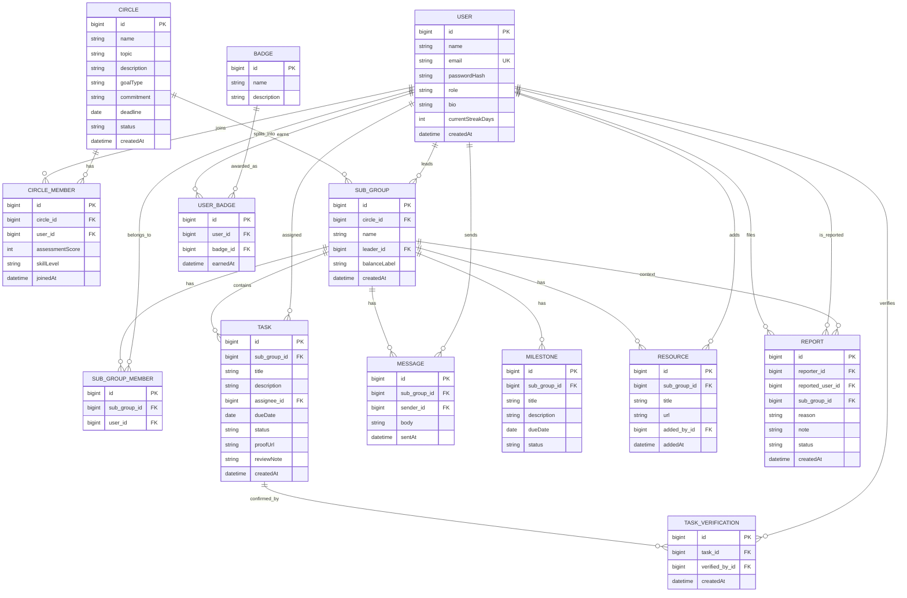

# SkillNest ER diagram

IDs are `BIGINT` auto-increment. Enums are stored as strings (`@Enumerated(EnumType.STRING)`). Relationships are unidirectional `@ManyToOne` from the child.

## Constraints

- `users.email` is unique.
- `circle_members` is unique on `(circle_id, user_id)`.
- `sub_group_members` is unique on `(sub_group_id, user_id)`.

## Enum values

| Field | Values |
| --- | --- |
| `USER.role` | LEARNER, ADMIN |
| `CIRCLE.goalType` | LEARN, BUILD, COMPETE |
| `CIRCLE.commitment` | CASUAL, SERIOUS |
| `CIRCLE.status` | OPEN, GROUPED, CLOSED |
| `CIRCLE_MEMBER.skillLevel` | BEGINNER, INTERMEDIATE, ADVANCED |
| `TASK.status` | IN_PROGRESS, PENDING_PEER_CONFIRMATION, VERIFIED, CHANGES_REQUESTED |
| `MILESTONE.status` | NOT_STARTED, IN_PROGRESS, COMPLETED |
| `REPORT.status` | OPEN, RESOLVED |
